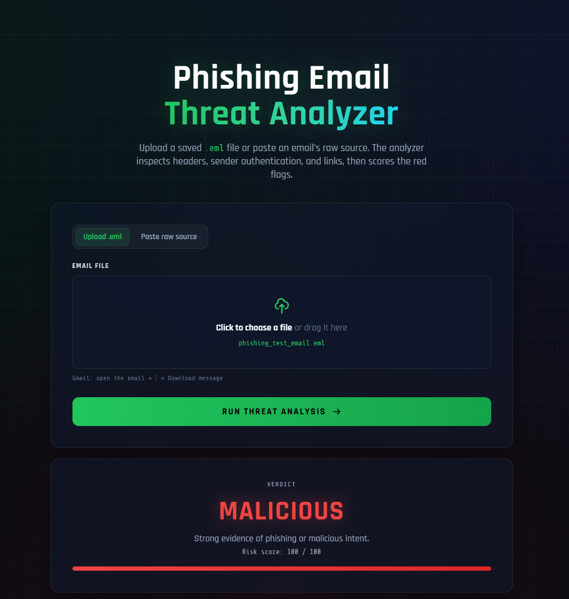

# Phishing Email Analyzer

Drop in a suspicious email and this tool tells you whether it looks like phishing, and more importantly, *why*.

You can upload a saved `.eml` file or paste the email's raw source. The analyzer goes through it the way a SOC analyst would: who really sent it, whether it passes email authentication, where the links actually go, what's attached, and how the message is trying to pressure you. Every red flag adds points, and the total decides the verdict: **Benign**, **Low Suspicion**, **High Suspicion**, or **Malicious**.

**Live demo:** [phishing-email-analyzer-xps9.onrender.com](https://phishing-email-analyzer-xps9.onrender.com/)

> The free hosting tier sleeps after inactivity, so the first visit may take about a minute to load.

<p align="center">
  
</p>

## Verdicts

| Score | Verdict |
| --- | --- |
| 0 | Benign |
| 1 to 19 | Low Suspicion |
| 20 to 49 | High Suspicion |
| 50 to 100 | Malicious |

## Why I built it

Phishing is still one of the easiest ways into a company, and sorting through reported emails is a big part of a SOC analyst's day. I wanted to understand what an analyst actually looks at when they decide an email is malicious, and then automate those checks.

I also didn't want a black box. There's no AI and no third-party detection API here. All of the detection logic is hand-written Python, so every finding points back to a specific rule you can read and explain.

## What it looks at

**The sender.** Is the email pretending to be a brand it isn't? It catches things like a "PayPal" display name on a random domain, lookalike domains (`paypa1`, `rnicrosoft`), company names sent from Gmail, and replies that quietly go to a different organization.

**Authentication.** It reads the SPF, DKIM, and DMARC results your mail server recorded. In short, these tell you whether the email really came from the domain it claims to be from. A DMARC failure on a big brand is one of the strongest signs of spoofing. (More on these [below](#spf-dkim-and-dmarc-explained).)

**The message itself.** It looks for the usual pressure tactics: urgency ("within 24 hours"), requests for passwords or personal info, gift card or wire transfer requests, "keep this between us", and generic greetings like "Dear Customer". It also flags emails with a login form built right into them, which real companies don't do.

**Links.** Every link gets pulled out and checked. Does the text say one thing while the link goes somewhere else? Is it a raw IP address, a URL shortener, a sketchy domain ending like `.xyz`, or a free hosting site where fake login pages usually live? It also catches older tricks like `paypal.com@evil.top`, which actually takes you to `evil.top`.

**Attachments.** Executables, scripts, macro-enabled Office files, HTML or SVG files (often fake login pages), double extensions like `invoice.pdf.exe`, and hidden characters that make a file name display backwards.

## SPF, DKIM, and DMARC explained

Email was designed in a time when everyone trusted each other, so by default anyone can put any address in the "From" line. Nothing stops a scammer from sending an email "from" `security@microsoft.com`. SPF, DKIM, and DMARC were added later to fix that. Here's what each one does, in plain terms:

**SPF (Sender Policy Framework)** is a guest list. A domain like `microsoft.com` publishes a list of the mail servers that are allowed to send email for it. When an email arrives, the receiving server checks whether it came from a server on that list. If not, SPF fails.

**DKIM (DomainKeys Identified Mail)** is a tamper-proof seal. The sending domain digitally signs the email, and the receiving server checks that signature using a public key the domain publishes. A valid signature proves the email really came from that domain and wasn't changed along the way.

**DMARC (Domain-based Message Authentication, Reporting and Conformance)** ties the other two to the name you actually see. SPF and DKIM can pass for *some* domain, like the scammer's own, while the From line says Microsoft. DMARC checks that SPF or DKIM passed for the same domain shown in the From address, and lets the domain owner say what to do with emails that don't match. A DMARC failure basically means "this email is claiming to be someone it isn't."

### How my code checks them

The analyzer doesn't re-run these checks itself. Your mail provider (Gmail, Outlook, etc.) already ran them when the email arrived and wrote the results into a header that looks like this:

```
Authentication-Results: mx.google.com;
    spf=fail smtp.mailfrom=security-notice.invalid;
    dkim=none;
    dmarc=fail header.from=microsoft.com
```

`read_auth_results()` in `analyzer.py` finds that header and pulls out the word after `spf=`, `dkim=`, and `dmarc=` using regular expressions. A few details matter:

- **Only the top header is trusted.** Every mail server that handles an email adds its header *above* the existing ones, so the top one always comes from your own provider. A scammer can type a fake `spf=pass dkim=pass dmarc=pass` header into the email before sending it, but it ends up lower down, so the code ignores it.
- **One good DKIM signature is enough.** Some emails carry more than one signature (for example, one from the company and one from the service that sends their newsletters). If any of them passed, DKIM counts as passed.
- **There's a fallback for SPF.** Some servers write the SPF result in a separate `Received-SPF` header instead, so the code checks there if it can't find SPF in the main one.

Then `check_authentication()` turns those results into points:

- **SPF fail:** +20 (a "softfail", which is a weaker failure, adds +10)
- **DKIM fail:** +15 (no signature at all, or another non-passing result, adds +5)
- **DMARC fail:** +25, the biggest single red flag in this section
- **No DMARC policy at all:** +5. It's not proof of anything, but it means nothing stops someone from faking that domain, and big brands always have one.
- **No authentication header:** +5. This usually happens when someone pastes only part of an email, so the tool tells you to paste the full source.

## How the score works

Each red flag adds points based on how serious it is. A DMARC failure adds 25 points, while a plain `http` link only adds 5. The score is capped at 100, and the total maps to one of the four verdicts in the [table at the top](#verdicts).

I set the bar low on purpose. If the tool flags a safe email, you lose a few seconds double-checking it. If it calls a phishing email safe, someone could lose their account.

The results show every finding grouped by area, with how many points it added, so you can see exactly how the score was reached.

## Built with

Python 3 (using the built-in `email` library for parsing), Flask, plain HTML, CSS, and JavaScript, and Gunicorn on Render.

`analyzer.py` holds all the detection logic and knows nothing about the website. `app.py` is just the web server that passes emails to it, and `templates/index.html` is the interface.

## Run it yourself

```
git clone https://github.com/0xRizk/phishing-email-analyzer.git
cd phishing-email-analyzer
pip install -r requirements.txt
python app.py
```

Then open http://127.0.0.1:5000. (On Windows, use `py` instead of `python` if `python` isn't recognized.)

The `samples/` folder has eight fake emails to try: five phishing attempts (fake PayPal, Microsoft, DocuSign, Canada Post, and a CEO gift card scam), one borderline marketing email, and two legitimate ones. To test a real email from Gmail, open it, click ⋮ then **Download message**, and upload the file.

## Keeping it safe

A tool that reads phishing emails has to assume every email is hostile, so:

- Nothing from an email is ever rendered as HTML. It's all shown as plain text, so a malicious email can't run code in your browser.
- Links are shown as text and are never clickable.
- Fake authentication headers are ignored. Only the top one, added by your own mail server, is trusted (explained above).
- Nothing is saved. Emails are analyzed in memory and thrown away.
- Uploads over 10 MB are rejected, and errors never show internal details.

## What it can't do (yet)

This is a rule-based learning project, not a replacement for a real email security gateway. It needs the full email with headers to check authentication, it doesn't look up links or files against threat intelligence, and someone who avoids the usual phishing phrases can slip past the content checks. Because the scoring is strict, some legitimate marketing emails will show up as Low or High Suspicion.

Things I'd like to add next:

- Checking links and file hashes against VirusTotal or URLhaus
- Flagging newly registered domains
- Automated tests for every rule
- Exporting results as a report

## Author

Made by **Rizk Hyatt**: [r1zk.com](https://www.r1zk.com) · [GitHub](https://github.com/0xRizk) · [LinkedIn](https://www.linkedin.com/in/rizk-hyatt-a740a4317/)